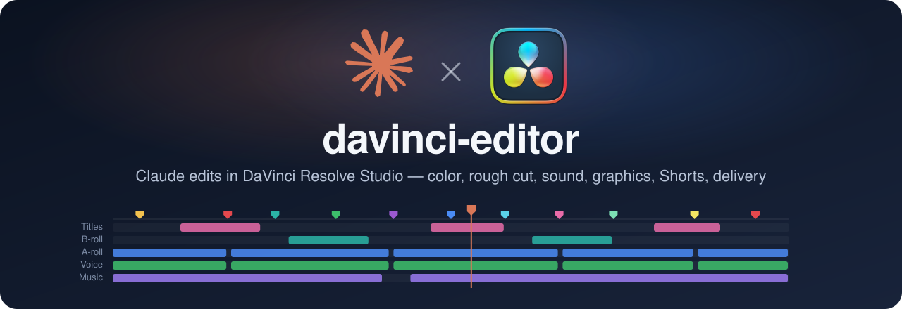

<p align="center">
  
</p>

<p align="center">
  <b>Your colored markers in, a finished YouTube episode out.</b><br>
  26 Claude skills that grade, cut, mix, title and deliver inside DaVinci Resolve Studio 21+,<br>
  stopping for your approval at every step and never touching your source timeline.
</p>

<p align="center">
  <a href="https://github.com/AratKruglik/davinci-editor/releases/latest"></a>
  
  
  
  
  
  <a href="LICENSE"></a>
</p>

<p align="center">
  <a href="#start-in-3-steps"><b>Start</b></a> ·
  <a href="#what-to-say"><b>What to say</b></a> ·
  <a href="#skills"><b>Skills</b></a> ·
  <a href="docs/install.md">Full install</a> ·
  <a href="docs/settings.md">Settings</a> ·
  <a href="#troubleshooting">Help</a>
</p>

|  | Stage | What Claude does |
|---|---|---|
| 🎨 | **Color** | Apple Log → Rec.709, chart match, natural skin, background blur |
| ✂️ | **Cut** | Ukrainian transcript, cuts fillers and bad takes, camera + screen PiP, J/L-cuts |
| 🎧 | **Sound** | voice cleanup, SFX and music from your library, -14 LUFS |
| 🚀 | **Ship** | titles, zooms, subtitles, chapters, Shorts, thumbnails, QC, H.265 render |

## Start in 3 steps

You need a Mac, **DaVinci Resolve Studio 21+** (not the free one), Python 3 (`python3 --version`), and Claude Code or Claude Desktop.

**1. Resolve.** Preferences → System → General → **External scripting using = Local**, restart. For Ukrainian: menu → **Extras Download Manager** → download the transcription models.

**2. Install.** Pick one:

- **Claude Desktop / Cowork:** download `davinci-editor-cowork-<version>.zip` from [Releases](https://github.com/AratKruglik/davinci-editor/releases/latest) → **Customize → Plugins → Add → Upload plugin**. Don't unzip it.
- **Claude Code:**

  ```bash
  claude mcp add --scope user DaVinci_Resolve -- "/Applications/DaVinci Resolve/DaVinci Resolve.app/Contents/Applications/ResolveMCP"
  claude plugin install davinci-editor --marketplace AratKruglik/davinci-editor
  ```

**3. Check.** Ask Claude: *"Check the connection to DaVinci Resolve and tell me the version."* It answers 21.x → you're done.

Something off, Resolve not in `/Applications`, or want details? → [Full install guide](docs/install.md).

## What to say

The whole episode, step by step, with a stop for your OK after each one (resumes in a new session):

```
/davinci-editor:edit-episode My episode
```

Or one thing at a time, in plain words:

- "convert A-Roll from Apple Log to 709"
- "make a rough cut of these clips"
- "clean up the voice, the air conditioner hums"
- "make 3 Shorts from this episode"

In the Cowork build commands start with `/davinci-editor-cowork:` instead. More prompts: [skill guide](docs/skills/README.md).

**First color run:** Claude asks you once to build 6 labeled nodes on a clip (`CHART → CST → PRIMARY → SKIN → DEPTH → LOOK`), saves them as a template and reuses it from then on.

**Markers = instructions.** Press `M` in Resolve and pick a color: Red = cut, Green = keep, Pink = zoom, Mint = Shorts, Blue = chapter… [Full color list](docs/marker-color-system.md).

**Safe by default.** Claude never touches your source timeline (the cut goes to a new one), never writes to media folders, and asks before deleting anything.

Defaults fit Ukrainian YouTube tutorials. To change one, just say it ("transcription language: en") or see [Settings](docs/settings.md).

## Skills

Click a name for its guide and example prompts.

| Skill | What it does |
|---|---|
| [`edit-episode`](docs/skills/edit-episode.md) | the whole workflow with approval stops |
| [`marker-edit`](docs/skills/marker-edit.md) | does what your colored markers say |
| [`project-bootstrap`](docs/skills/project-bootstrap.md) | new project, bins, import |
| [`log-to-rec709`](docs/skills/log-to-rec709.md) | Apple Log → Rec.709 |
| [`chart-match`](docs/skills/chart-match.md) | color match from a ColorChecker |
| [`natural-skin-grade`](docs/skills/natural-skin-grade.md) | neutral balance, natural skin |
| [`depth-background-blur`](docs/skills/depth-background-blur.md) | blurred background |
| [`uk-transcribe`](docs/skills/uk-transcribe.md) | Ukrainian transcript (JSON/SRT/TXT) |
| [`text-based-cut`](docs/skills/text-based-cut.md) | rough cut from the transcript |
| [`dual-video-sync-pip`](docs/skills/dual-video-sync-pip.md) | camera + screen sync, PiP |
| [`split-edits`](docs/skills/split-edits.md) | J- and L-cuts |
| [`track-layout`](docs/skills/track-layout.md) | tracks by role, colors, locks |
| [`voice-isolation`](docs/skills/voice-isolation.md) | removes background noise from voice |
| [`sound-design`](docs/skills/sound-design.md) | SFX, music, ambience from your library |
| [`audio-effects`](docs/skills/audio-effects.md) | live music, room reverb, pan sweeps, vocals out of a song |
| [`audio-finish`](docs/skills/audio-finish.md) | level dialogue, -14 LUFS |
| [`motionvfx-catalog`](docs/skills/motionvfx-catalog.md) | finds your MotionVFX / Fusion templates |
| [`fusion-motion-graphics`](docs/skills/fusion-motion-graphics.md) | titles, callouts, counters |
| [`tutorial-zooms`](docs/skills/tutorial-zooms.md) | zooms onto the screen, punch-ins |
| [`subtitles-uk`](docs/skills/subtitles-uk.md) | Ukrainian subtitles, Shorts captions |
| [`chapters-markers`](docs/skills/chapters-markers.md) | YouTube chapters |
| [`shorts-cutdown`](docs/skills/shorts-cutdown.md) | vertical Shorts |
| [`thumbnail-frames`](docs/skills/thumbnail-frames.md) | best frames for a thumbnail |
| [`frame-critic`](docs/skills/frame-critic.md) | checks placed titles, zooms and captions: cut off, unreadable, too short |
| [`pre-delivery-qc`](docs/skills/pre-delivery-qc.md) | checks before render |
| [`edit-judge`](docs/skills/edit-judge.md) | independent verdict: ship or rework, with timecodes; ranks Shorts and thumbnails |
| [`deliver`](docs/skills/deliver.md) | H.265 renders for YouTube and Shorts |
| [`edit-memory`](docs/skills/edit-memory.md) | learns from your manual edits; rules only after your yes |
| [`resolve-core`](docs/skills/resolve-core.md) | hidden shared rules |

## Troubleshooting

| Problem | Fix |
|---|---|
| Every skill shows up twice | both builds installed; keep one ([why](docs/install.md#step-2b-claude-desktop-and-cowork)) |
| No Resolve tools / `DaVinci_Resolve` **Failed** | wrong `ResolveMCP` path ([install](docs/install.md#step-1-prepare-davinci-resolve)) |
| Resolve doesn't respond | start it, check **External scripting = Local**, close any open dialogs |
| Claude asks permission for every Resolve call | the server must be named exactly `DaVinci_Resolve` |
| Skills missing under `/` | `/reload-plugins` in Claude Code; in Desktop check the plugin is enabled |
| Transcript is English gibberish | download the transcription models (step 1) |
| `python3: command not found` | `xcode-select --install` |
| `chart-match` says "unsupported TIFF" | tell Claude, it tries another still format |

## Development

```bash
python3 skills/resolve-core/scripts/tc.py selftest
python3 skills/chart-match/scripts/test_chart_match.py
python3 skills/text-based-cut/scripts/test_cut_candidates.py
python3 skills/resolve-core/scripts/guard.py selftest
python3 skills/natural-skin-grade/scripts/test_skin_grade.py
python3 skills/motionvfx-catalog/scripts/test_catalog.py
python3 skills/dual-video-sync-pip/scripts/pip_plan.py selftest
python3 skills/split-edits/scripts/split_edits.py selftest
python3 skills/jump-cuts/scripts/jump_cuts.py selftest
python3 skills/sound-design/scripts/test_sound_library.py
python3 skills/audio-finish/scripts/loudness.py selftest
python3 skills/resolve-core/scripts/timeline_map.py selftest
python3 skills/resolve-core/scripts/placed.py selftest
python3 skills/fusion-motion-graphics/scripts/motion.py selftest
python3 skills/tutorial-zooms/scripts/zooms.py selftest
python3 skills/subtitles-uk/scripts/subtitles.py selftest
python3 skills/shorts-cutdown/scripts/shorts.py selftest
python3 skills/chapters-markers/scripts/chapters.py selftest
python3 skills/thumbnail-frames/scripts/thumbs.py selftest
python3 skills/pre-delivery-qc/scripts/qc.py selftest
python3 skills/frame-critic/scripts/critic.py selftest
python3 skills/edit-memory/scripts/memory.py selftest
python3 skills/edit-judge/scripts/judge.py selftest
python3 skills/deliver/scripts/mp4_info.py selftest
python3 skills/uk-transcribe/scripts/transcript_export.py selftest
claude plugin validate .
claude plugin eval . --allow-tools Write,Edit,Bash --scaffold   # eval cases in skills/*/evals (real, billed model runs)
```

Skill eval cases live in `skills/<skill>/evals/`; the offline fixtures don't need a running Resolve.

### Releasing

The Cowork zip is built from the same `skills/` by `scripts/build_cowork.py`: it renames the plugin to `davinci-editor-cowork`, bundles `.mcp.json` with Resolve's server, rewrites the skills' pre-approved tool names to the plugin-scoped ones (`mcp__plugin_davinci-editor-cowork_DaVinci_Resolve__*`) and leaves out the eval fixtures.

1. Bump `version` in `.claude-plugin/plugin.json`.
2. Commit, then tag and push: `git tag v0.4.0 && git push origin v0.4.0` (the tag must match the version).
3. The `release` workflow runs the self-tests, builds `davinci-editor-cowork-<version>.zip` and publishes it on the GitHub release.

Local build: `python3 scripts/build_cowork.py` → `dist/`.

## Credits and trademarks

The plugin's code and documentation are under the [MIT license](LICENSE); the logos and the banner are not. davinci-editor is an independent project, not affiliated with or endorsed by Anthropic or Blackmagic Design. Claude is a trademark of Anthropic. DaVinci Resolve is a trademark of Blackmagic Design. The logos in `assets/logos/` come from Wikimedia Commons: [Claude AI symbol](https://commons.wikimedia.org/wiki/File:Claude_AI_symbol.svg) (CC0) and [DaVinci Resolve Studio](https://commons.wikimedia.org/wiki/File:DaVinci_Resolve_Studio.png) by Blackmagic Design ([CC BY-SA 4.0](https://creativecommons.org/licenses/by-sa/4.0)). The header banner (`assets/banner.svg`) contains both logos and is shared under CC BY-SA 4.0.
